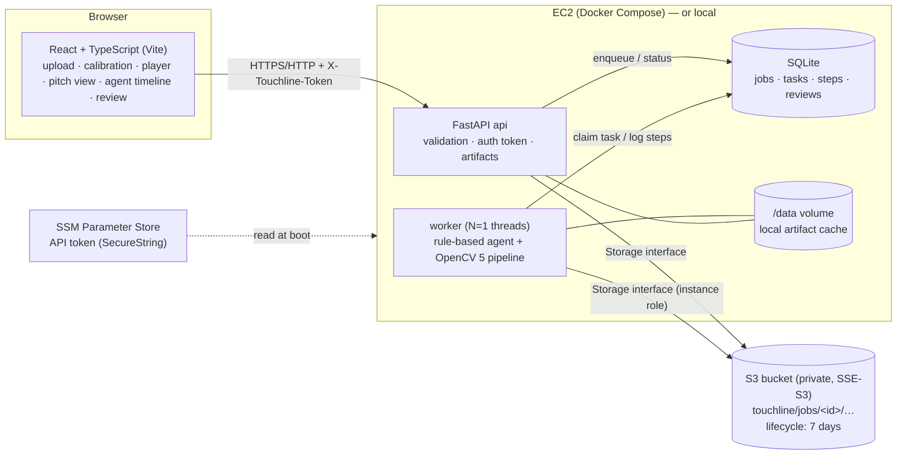
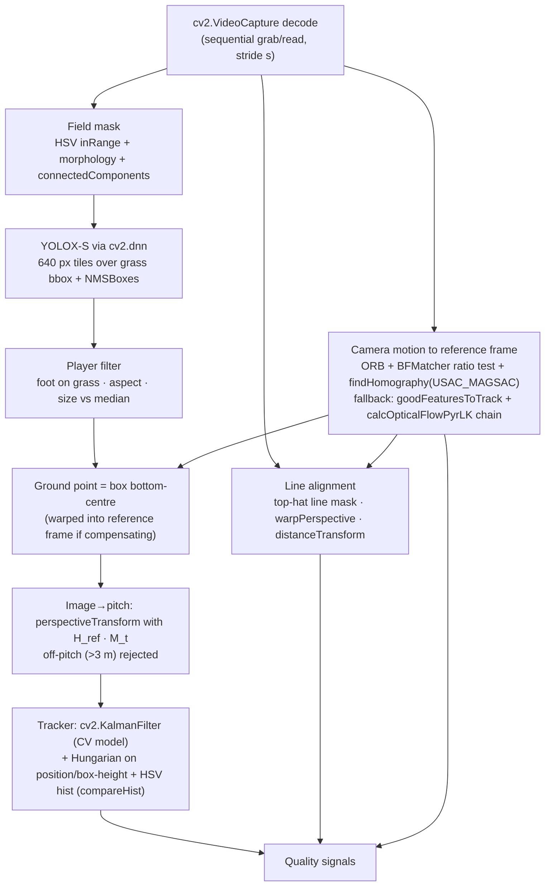
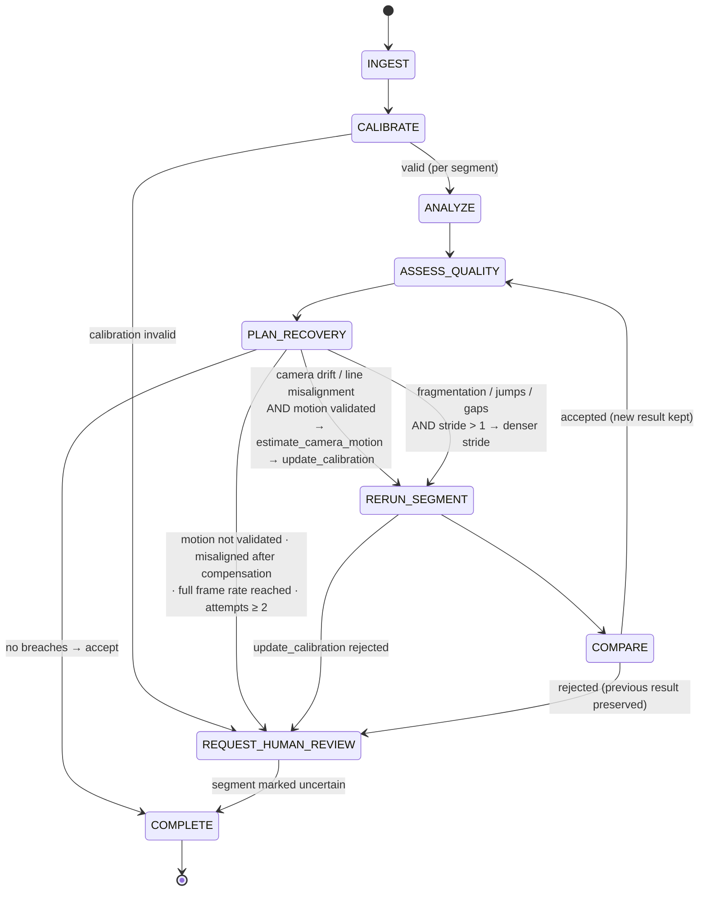

# Architecture

## System

The same `Storage` protocol (`backend/touchline/storage.py`) has a local-filesystem implementation for development and an
S3 implementation for AWS (instance-role credentials, SSE on every object, prefix-scoped keys). Processing always works on
local files: inputs are fetched into a cache, outputs are uploaded when finished.

## Vision pipeline (per sampled frame)

## Agent workflow

Human actions after `REQUEST_HUMAN_REVIEW` (UI "Human review" panel): **approve proposed rerun** (runs the agent's proposal
beyond the automatic budget, still subject to `compare_runs`), **correct field points** (new calibration → new run), or
**accept as-is** (segment included, flagged `reviewer_accepted`). Team colours/track overrides re-assemble the outputs
without re-running vision. Human steps are logged in the same trace with `actor: "human"`.

## Tools

| Tool | Input | Output |
|---|---|---|
| `analyze_segment` | segment id, frame range, `SegmentConfig` (stride, motion_compensation, motion_model) | result id, per-frame detections/motion/alignment, tracks |
| `assess_tracking_quality` | result id, optional frame set | signals + breaches |
| `estimate_camera_motion` | segment, stride | per-frame frame→reference homographies + validation stats |
| `update_calibration` | motion id | accepted?, probe-frame line alignment static vs updated, per-frame model |
| `rerun_segment` | segment, new config, attempt | new result id |
| `compare_runs` | before id, after id, target signals | accepted?, per-signal deltas on identical frames |
| `request_human_review` | segment, reason, kind, proposed config | review id |
